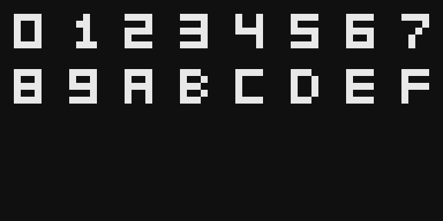

# emulador-chip8


[](https://github.com/larissaribeiro-dev/emulador-chip8/actions/workflows/ci.yml)

Emulador de CHIP-8 escrito em C++17. O CHIP-8 é uma máquina virtual de 8 bits criada nos anos 70 para rodar jogos simples em computadores domésticos, e é um bom exercício porque cabe inteiro na cabeça: 4 KiB de memória, 16 registradores, 35 instruções e uma tela de 64x32 pixels.

O emulador lê uma ROM, executa o ciclo de busca, decodificação e execução instrução por instrução e desenha o resultado numa janela SDL2, com teclado hexadecimal e beep. O núcleo não conhece o SDL, então tudo o que a CPU faz pode ser testado sem abrir janela.

```
$ chip8 --headless 8 --trace roms/demo.ch8

PC=0x200  00E0  CLS              I=0x000 SP=0 V=00 00 00 00 00 00 00 00 00 00 00 00 00 00 00 00
PC=0x202  6200  LD V2, 0x00      I=0x000 SP=0 V=00 00 00 00 00 00 00 00 00 00 00 00 00 00 00 00
PC=0x204  6002  LD V0, 0x02      I=0x000 SP=0 V=00 00 00 00 00 00 00 00 00 00 00 00 00 00 00 00
PC=0x206  6102  LD V1, 0x02      I=0x000 SP=0 V=02 00 00 00 00 00 00 00 00 00 00 00 00 00 00 00
PC=0x208  F229  LD F, V2         I=0x000 SP=0 V=02 02 00 00 00 00 00 00 00 00 00 00 00 00 00 00
PC=0x20A  D015  DRW V0, V1, 5    I=0x050 SP=0 V=02 02 00 00 00 00 00 00 00 00 00 00 00 00 00 00
```

## Recursos

- 34 das 35 instruções do CHIP-8, com busca, decodificação e execução na CPU (a `0NNN`, que chama código de máquina, fica de fora de propósito)
- Memória de 4 KiB, registradores V0 a VF, registrador de endereço I, PC e pilha de 16 níveis
- Temporizadores de delay e de som a 60 Hz, independentes da velocidade da CPU
- Teclado hexadecimal de 16 teclas mapeado em `1234 / QWER / ASDF / ZXCV`
- Tela monocromática de 64x32 com desenho por XOR e detecção de colisão
- Beep gerado por onda quadrada enquanto o temporizador de som está ativo
- Carregador de ROM com validação de tamanho
- Instruções inválidas, acessos fora da memória e estouro de pilha viram erros controlados, sem travar o programa
- Duas variantes de comportamento selecionáveis (`vip` e `moderno`), documentadas na seção de quirks
- Modo de depuração com rastreio de instruções, execução sem janela e despejo de memória
- 105 testes unitários e de integração com GoogleTest, e uma ROM de demonstração própria

## Como funciona

A classe `Chip8` junta os cinco componentes da máquina. A CPU é a única que conversa com os outros, e o frontend SDL só enxerga a `Chip8` por fora: manda as teclas, pede os pixels e pergunta se deve tocar o beep.

```
  +-------------------------------------------------------+
  |                         Chip8                         |
  |                                                       |
  |   +--------+        +----------+                      |
  |   |        |<------>|  Memory  |  4 KiB, fonte, ROM   |
  |   |        |        +----------+                      |
  |   |        |        +----------+                      |
  |   |  Cpu   |------->| Display  |  64x32, XOR          |
  |   |        |        +----------+                      |
  |   |        |        +----------+                      |
  |   |        |<-------|  Keypad  |  16 teclas           |
  |   |        |        +----------+                      |
  |   |        |        +----------+                      |
  |   |        |<------>|  Timers  |  delay e sound       |
  |   +--------+        +----------+                      |
  +----------------------------^--------------------------+
                               |
                 +-------------+-------------+
                 |  frontend (SDL2)          |
                 |  janela, teclado, áudio   |
                 +---------------------------+
```

Em cada quadro de 1/60 s o frontend executa um lote de instruções (700 por segundo por padrão), decrementa os temporizadores uma vez e redesenha a tela se ela mudou.

### Módulos

| Módulo | Arquivos | Função |
|--------|----------|--------|
| Máquina | `chip8.hpp/.cpp` | Liga CPU, memória, vídeo, teclado e temporizadores |
| CPU | `cpu.hpp/.cpp` | Registradores, pilha e o ciclo busca, decodificação e execução |
| Memória | `memory.hpp/.cpp` | 4 KiB de RAM, fonte hexadecimal e carga da ROM |
| Vídeo | `display.hpp/.cpp` | Framebuffer de 64x32 e desenho de sprites |
| Teclado | `keypad.hpp/.cpp` | Estado das 16 teclas e evento de soltura para `FX0A` |
| Temporizadores | `timers.hpp` | Delay e sound a 60 Hz |
| Variantes | `quirks.hpp` | Flags que diferenciam o CHIP-8 original das variantes |
| Erros | `errors.hpp/.cpp` | Exceções tipadas do emulador |
| ROM | `rom.hpp/.cpp` | Leitura e validação do arquivo |
| Disassembler | `disassembler.hpp/.cpp` | Traduz opcodes em mnemônicos |
| Depuração | `debug.hpp/.cpp` | Linha de rastreio, registradores e hexdump |
| Plataforma | `frontend/platform.*` | Janela, teclado e áudio com SDL2 |
| Programa | `frontend/main.cpp` | Argumentos, laço principal e modo headless |

### Mapa de memória

| Faixa | Conteúdo |
|-------|----------|
| `0x000` a `0x04F` | Reservada, fica zerada |
| `0x050` a `0x09F` | Fonte com os dígitos `0` a `F`, 5 bytes por glifo |
| `0x0A0` a `0x1FF` | Livre |
| `0x200` a `0xFFF` | Programa (até 3584 bytes) e dados |

## Conjunto de instruções

Cada instrução tem 2 bytes, em big-endian. Na tabela, `NNN` é um endereço de 12 bits, `NN` um byte, `N` um nibble e `X` e `Y` são índices de registrador.

| Opcode | Mnemônico | Operação |
|--------|-----------|----------|
| `00E0` | `CLS` | Apaga a tela |
| `00EE` | `RET` | Volta da sub-rotina |
| `1NNN` | `JP NNN` | PC recebe NNN |
| `2NNN` | `CALL NNN` | Empilha o PC e salta para NNN |
| `3XNN` | `SE VX, NN` | Pula a próxima instrução se VX == NN |
| `4XNN` | `SNE VX, NN` | Pula se VX != NN |
| `5XY0` | `SE VX, VY` | Pula se VX == VY |
| `6XNN` | `LD VX, NN` | VX recebe NN |
| `7XNN` | `ADD VX, NN` | VX += NN, sem alterar VF |
| `8XY0` | `LD VX, VY` | VX recebe VY |
| `8XY1` | `OR VX, VY` | VX \|= VY |
| `8XY2` | `AND VX, VY` | VX &= VY |
| `8XY3` | `XOR VX, VY` | VX ^= VY |
| `8XY4` | `ADD VX, VY` | VX += VY, VF = 1 se houve carry |
| `8XY5` | `SUB VX, VY` | VX -= VY, VF = 1 se não houve empréstimo |
| `8XY6` | `SHR VX, VY` | Desloca à direita, VF recebe o bit descartado |
| `8XY7` | `SUBN VX, VY` | VX = VY - VX, VF = 1 se não houve empréstimo |
| `8XYE` | `SHL VX, VY` | Desloca à esquerda, VF recebe o bit descartado |
| `9XY0` | `SNE VX, VY` | Pula se VX != VY |
| `ANNN` | `LD I, NNN` | I recebe NNN |
| `BNNN` | `JP V0, NNN` | PC recebe NNN + V0 |
| `CXNN` | `RND VX, NN` | VX recebe um byte aleatório AND NN |
| `DXYN` | `DRW VX, VY, N` | Desenha N linhas do sprite em I na posição (VX, VY), VF = colisão |
| `EX9E` | `SKP VX` | Pula se a tecla VX está pressionada |
| `EXA1` | `SKNP VX` | Pula se a tecla VX não está pressionada |
| `FX07` | `LD VX, DT` | VX recebe o delay timer |
| `FX0A` | `LD VX, K` | Espera uma tecla ser pressionada e solta, e guarda em VX |
| `FX15` | `LD DT, VX` | Delay timer recebe VX |
| `FX18` | `LD ST, VX` | Sound timer recebe VX |
| `FX1E` | `ADD I, VX` | I += VX |
| `FX29` | `LD F, VX` | I aponta para o glifo do dígito VX |
| `FX33` | `LD B, VX` | Guarda VX em BCD em I, I+1 e I+2 |
| `FX55` | `LD [I], VX` | Copia V0..VX para a memória a partir de I |
| `FX65` | `LD VX, [I]` | Copia a memória a partir de I para V0..VX |

### Ciclo de execução

Cada chamada a `Cpu::step()` faz as três fases.

1. **Busca.** Lê dois bytes em `PC` e `PC+1` e monta o opcode de 16 bits.
2. **Avanço.** Soma 2 ao PC. Saltos e chamadas sobrescrevem esse valor depois.
3. **Decodificação e execução.** Um `switch` no nibble alto escolhe a família, e os campos X, Y, N, NN e NNN são extraídos da máscara do opcode.

Uma instrução bloqueante, a `FX0A`, é implementada sem bloquear a thread: enquanto nenhuma tecla é solta, a CPU volta o PC em 2 e repete a própria instrução. Assim os temporizadores e a janela continuam funcionando.

## Variantes e quirks

O CHIP-8 foi reimplementado várias vezes ao longo das décadas e algumas instruções mudaram de comportamento entre as versões. O emulador isola essas diferenças em três flags, agrupadas em dois perfis escolhidos por `--quirks`.

| Comportamento | Instruções | `vip` (COSMAC VIP, 1977) | `moderno` (padrão) |
|---------------|------------|--------------------------|--------------------|
| Deslocamento | `8XY6`, `8XYE` | Lê VY e grava em VX | Desloca o próprio VX e ignora VY |
| Cópia de registradores | `FX55`, `FX65` | I termina em I + X + 1 | I não muda |
| Operações lógicas | `8XY1`, `8XY2`, `8XY3` | VF é zerado | VF não muda |

O perfil `moderno` segue o que a maioria dos materiais de referência descreve e é o que a maior parte das ROMs espera. Se uma ROM antiga se comportar de forma estranha, vale tentar `--quirks vip`.

Decisões que valem para os dois perfis.

- **Sprites.** A coordenada inicial dá a volta na tela (módulo 64 e 32), mas o resto do sprite é cortado nas bordas e não reaparece do outro lado.
- **`0NNN`.** A chamada de código de máquina do computador original não é suportada e gera `UnknownOpcodeError`. Isso também faz uma ROM que cai em memória vazia (`0000`) parar com erro em vez de rodar sem fazer nada.
- **`BNNN`.** Sempre soma V0. A variante `BXNN` do SUPER-CHIP não está implementada.
- **`FX1E`.** Não altera VF.
- **`EX9E` e `EXA1`.** Só o nibble baixo de VX é usado como número da tecla.
- **Flags em `8XY4` a `8XYE`.** VF é gravado depois do resultado, então `8F14` termina com o flag em VF, e não com a soma.
- **Espera de vblank.** O `DXYN` desenha na hora, sem esperar o próximo quadro como o COSMAC VIP fazia.
- **Fora do escopo.** SUPER-CHIP (tela 128x64, sprites 16x16) e XO-CHIP.

## Como rodar

Requer um compilador C++17, CMake 3.16 ou superior, Ninja (opcional, mas recomendado) e SDL2. O GoogleTest é baixado automaticamente pelo CMake na primeira configuração, então ela precisa de internet.

### Windows 11 com VS Code

1. Instale o [VS Code](https://code.visualstudio.com/) e, nele, as extensões **C/C++** e **CMake Tools**.
2. Instale o [MSYS2](https://www.msys2.org/). Abra o terminal **MSYS2 UCRT64** e rode:

   ```bash
   pacman -Syu
   pacman -S --needed mingw-w64-ucrt-x86_64-gcc mingw-w64-ucrt-x86_64-cmake \
       mingw-w64-ucrt-x86_64-ninja mingw-w64-ucrt-x86_64-SDL2 mingw-w64-ucrt-x86_64-gdb
   ```

3. Adicione `C:\msys64\ucrt64\bin` à variável de ambiente `Path` do Windows. É de lá que o executável carrega o `SDL2.dll`.
4. Na raiz do projeto, em um terminal novo:

   ```bash
   cmake -S . -B build -G Ninja
   cmake --build build
   ctest --test-dir build --output-on-failure
   ./build/chip8 roms/demo.ch8
   ```

No VS Code, rode `CMake: Scan for Kits`, escolha o kit `GCC ... ucrt64` e use a barra inferior para configurar, compilar e rodar.

### Linux (e WSL)

```bash
sudo apt install build-essential cmake ninja-build libsdl2-dev
cmake -S . -B build -G Ninja
cmake --build build
ctest --test-dir build --output-on-failure
./build/chip8 roms/demo.ch8
```

No WSL2 do Windows 11 a janela abre pelo WSLg, sem configuração extra.

### Opções

```
chip8 [opções] <rom.ch8>

  --scale N            tamanho de cada pixel na janela (padrão 12)
  --ips N              instruções por segundo (padrão 700)
  --quirks vip|moderno comportamento das instruções ambíguas (padrão moderno)
  --trace              imprime cada instrução executada
  --headless N         executa N instruções sem janela e mostra o estado final
  --dump-mem INI:TAM   com --headless, mostra TAM bytes da memória a partir de INI
  -h, --help           mostra esta ajuda
```

O programa devolve `0` em caso de sucesso, `1` se a ROM ou a execução falhar e `2` se os argumentos forem inválidos.

### Teclado

O teclado hexadecimal original fica mapeado no bloco esquerdo do teclado do computador, por posição física das teclas. Funciona igual em layouts ABNT2 e QWERTY. `Esc` fecha o emulador.

```
  CHIP-8          Teclado
  1 2 3 C         1 2 3 4
  4 5 6 D   ->    Q W E R
  7 8 9 E         A S D F
  A 0 B F         Z X C V
```

### ROMs

O repositório inclui só a `roms/demo.ch8`, escrita para este projeto (a listagem com comentários está em `roms/demo.lst`). Para outros programas, procure ROMs de domínio público ou com licença livre e coloque na pasta `roms/`. As ROMs de teste do [chip8-test-suite](https://github.com/Timendus/chip8-test-suite) são uma boa referência para conferir a CPU.

## Modo de depuração

Com `--headless N` o emulador executa N instruções sem abrir janela e imprime os registradores, a pilha, os temporizadores e a tela em ASCII. Com `--trace` ele mostra cada instrução antes de executá-la, e com `--dump-mem` mostra um trecho da memória. Isso permite inspecionar a máquina e usar o emulador em scripts e na integração contínua.

```
$ chip8 --headless 400 --dump-mem 0x050:16 roms/demo.ch8

Estado após 400 instruções
PC = 0x21C   I = 0x09B   SP = 0
V0 = 0x02   V1 = 0x0A   V2 = 0x10   V3 = 0x00
V4 = 0x00   V5 = 0x00   V6 = 0x00   V7 = 0x00
V8 = 0x00   V9 = 0x00   VA = 0x00   VB = 0x00
VC = 0x00   VD = 0x00   VE = 0x00   VF = 0x00
Pilha: vazia
Delay = 0   Sound = 0

................................................................
................................................................
..####......#.....####....####....#..#....####....####....####..
..#..#.....##........#.......#....#..#....#.......#..........#..
...

Memória
050: F0 90 90 90 F0 20 60 20 20 70 F0 10 F0 80 F0 F0
```

Uma instrução inválida interrompe a execução e mostra o estado em que a CPU parou.

```
erro: instrução desconhecida 0xFFFF em PC=0x200
PC = 0x202   I = 0x000   SP = 0
...
```

## Testes

São 105 testes com GoogleTest, rodados com `ctest` ou direto em `build/tests/chip8_tests`. Nenhum depende de ROM de terceiros: os programas de teste são montados opcode por opcode nos próprios testes.

| Arquivo | O que cobre | Testes |
|---------|-------------|--------|
| `test_cpu_arithmetic.cpp` | `6XNN`, `7XNN`, `8XY0` a `8XYE`, flags, VF como destino, os dois perfis de quirks | 18 |
| `test_cpu_flow.cpp` | Saltos, `CALL`/`RET`, estouro e esvaziamento da pilha, skips, `BNNN`, opcode inválido | 15 |
| `test_cpu_io.cpp` | `DXYN`, teclado, `FX0A`, temporizadores, `CXNN` com gerador injetado | 14 |
| `test_cpu_memory.cpp` | `ANNN`, `FX1E`, `FX29`, `FX33`, `FX55`, `FX65` e acessos fora da memória | 12 |
| `test_display.cpp` | XOR, colisão, wrap da coordenada inicial, corte nas bordas | 11 |
| `test_integration.cpp` | Laço de soma com BCD, sub-rotinas, espera de tecla com timers, reset, trace e hexdump | 9 |
| `test_memory.cpp` | Fonte, limites da RAM, carga de programa | 8 |
| `test_keypad.cpp` | Teclas, evento de soltura | 5 |
| `test_rom.cpp` | Arquivo ausente, vazio, grande demais e no tamanho máximo | 5 |
| `test_demo_rom.cpp` | Executa `demo.ch8` e confere a tela, o beep e a tecla pressionada | 3 |
| `test_timers.cpp` | Contagem, piso em zero, beep | 3 |
| `test_disassembler.cpp` | As 34 formas de instrução e os opcodes inválidos | 2 |

O gerador de números aleatórios da CPU é injetável, o que torna o `CXNN` determinístico nos testes. Para conferir que os testes realmente pegam erros, foram feitas alterações propositais no código da CPU (inverter o flag de `SUB`, fazer `FX55` sempre avançar I) e cada uma derrubou o teste correspondente.

### ROMs de terceiros

Além dos testes automatizados, os quatro primeiros programas do chip8-test-suite foram executados no modo headless com o perfil padrão e passaram: logo do CHIP-8, logo da IBM, Corax+ (todas as instruções com o sinal de aprovado) e Flags (todos os flags com o sinal de aprovado). Para repetir:

```bash
./build/chip8 --headless 20000 3-corax+.ch8
```

Os programas `5-quirks`, `6-keypad` e `7-beep` do mesmo conjunto dependem de teclado e som e precisam ser conferidos com a janela aberta.

## Demonstração

A ROM `demo.ch8` desenha os 16 dígitos da fonte embutida e depois espera uma tecla. Ao soltar a tecla, mostra o dígito correspondente no centro da tela e toca um beep curto. Ela exercita `CLS`, `LD`, `ADD`, `SE`, `JP`, `DRW`, `LD F`, `LD K` e `LD ST`.

| | |
|:---:|:---:|
|  |  |
| Tela depois de 400 instruções | Depois de pressionar e soltar a tecla `A` (`Z` no teclado) |

As imagens foram geradas a partir do framebuffer do próprio emulador.

## Estrutura do projeto

```
emulador-chip8/
├── src/
│   ├── core/                     # núcleo, sem dependência de SDL
│   │   ├── chip8.hpp / .cpp
│   │   ├── cpu.hpp / .cpp
│   │   ├── memory.hpp / .cpp
│   │   ├── display.hpp / .cpp
│   │   ├── keypad.hpp / .cpp
│   │   ├── timers.hpp
│   │   ├── quirks.hpp
│   │   ├── errors.hpp / .cpp
│   │   ├── rom.hpp / .cpp
│   │   ├── disassembler.hpp / .cpp
│   │   └── debug.hpp / .cpp
│   └── frontend/                 # janela, teclado e áudio
│       ├── platform.hpp / .cpp
│       └── main.cpp
├── tests/                        # GoogleTest
├── roms/                         # demo.ch8 e sua listagem
├── docs/                         # imagens do README
├── .github/workflows/ci.yml
├── CMakeLists.txt
├── .gitignore
├── .gitattributes
├── LICENSE
└── README.md
```

## Decisões de projeto

**Por que o núcleo não conhece o SDL?** O SDL só aparece em `frontend/`. A biblioteca `chip8_core` roda em qualquer lugar e é a que os testes usam, então a CPU é verificada sem janela, sem áudio e sem display, inclusive na integração contínua.

**Por que erros viram exceções?** Uma ROM malformada é uma entrada inválida e não um bug do emulador. `UnknownOpcodeError`, `MemoryAccessError`, `StackError` e `RomError` carregam o endereço ou o opcode que causou a falha, e o `main` os transforma em mensagem e código de saída. A memória confere todos os acessos em vez de usar índices soltos de um array.

**Por que os quirks são uma struct e não `#ifdef`?** Com flags em tempo de execução um mesmo binário roda os dois perfis, e os testes cobrem os dois caminhos de cada instrução ambígua.

**Por que a `FX0A` repete a instrução em vez de bloquear?** O laço principal controla o ritmo da janela e dos temporizadores. Voltar o PC em 2 mantém tudo funcionando enquanto a ROM espera. A instrução só termina quando a tecla é solta, e uma soltura anterior à instrução é descartada para não ser aproveitada por engano.

**Por que os temporizadores ficam fora da CPU?** Eles decrescem a 60 Hz, não a cada instrução. A CPU roda a uma taxa configurável (`--ips`) e o frontend chama `tick_timers()` uma vez por quadro, então mudar a velocidade da CPU não muda a duração do delay nem do beep.

**Por que existe o modo headless?** Foi a forma de validar o emulador com ROMs reais dentro de um terminal e de automatizar a conferência. Ele também serve para mostrar o estado da máquina, o que faz parte de depurar um emulador.

**Por que o `0NNN` é um erro e não um no-op?** Ele chamava código de máquina do computador original, que não existe aqui. Ignorar em silêncio esconderia uma ROM corrompida ou um salto para memória vazia.

## Limitações

- Não emula a espera de vblank do `DXYN`, então algumas ROMs muito sensíveis a tempo podem rodar mais rápido que no original.
- O som é uma onda quadrada fixa de 440 Hz, sem controle de volume.
- Não há pausa, reinício nem seleção de ROM pela janela: a ROM é escolhida na linha de comando.
- Os passos de instalação no Windows e a compilação pelo MSYS2 não são cobertos pela integração contínua, que roda só em Ubuntu.

## Roadmap

- [ ] Depurador com execução passo a passo
- [ ] Breakpoints
- [ ] Visualização dos registradores e da memória na própria janela
- [ ] Histórico das últimas instruções executadas
- [ ] Emulação opcional da espera de vblank
- [ ] Suporte ao SUPER-CHIP, somente depois de a versão básica estar estável
- [ ] Exportação do estado da CPU para JSON

## Referências

1. GREENE, Thomas P. *Cowgod's Chip-8 Technical Reference v1.0*. 1997. Disponível em: <http://devernay.free.fr/hacks/chip8/C8TECH10.HTM>.
2. LANGHOFF, Tobias V. *Guide to making a CHIP-8 emulator*. Disponível em: <https://tobiasvl.github.io/blog/write-a-chip-8-emulator/>.
3. TIMENDUS. *CHIP-8 test suite*. Disponível em: <https://github.com/Timendus/chip8-test-suite>.
4. CHIP-8. *Wikipedia*. Disponível em: <https://en.wikipedia.org/wiki/CHIP-8>.
5. SDL2 Wiki. Disponível em: <https://wiki.libsdl.org/SDL2>.

## Autora

Larissa Rafaela Ribeiro de Souza, estudante de Engenharia da Computação.

## Licença

Distribuído sob a licença MIT. Veja o arquivo [LICENSE](LICENSE).
